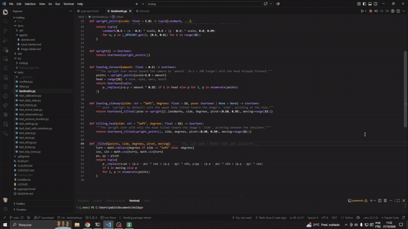

<p align="center">
  <picture>
    <source media="(prefers-color-scheme: dark)" srcset="assets/logo-dark.svg">
    
  </picture>
</p>

<p align="center">Stop leaning into your screen.</p>

<p align="center">
  <a href="https://pablossena.github.io/holdup/">Website</a> |
  <a href="https://github.com/PabloSSena/holdup/releases/latest">Download</a> |
  <a href="LICENSE">License (MIT)</a> |
  <a href="#development">Contribute</a>
</p>

<p align="center"></p>

A tray app for Windows, macOS and Linux that watches your sitting posture through your own camera. When you lean forward or to one side for more than 5 seconds, a small Mirror of your live camera feed appears in the bottom-left corner of the screen, and it disappears as soon as you sit well again.

Camera frames are analysed in memory and discarded. Nothing is recorded or sent anywhere.

- **Calibration**: at first launch you sit up straight for a few seconds to capture your Baseline; every judgement compares against it. If the camera view changes a lot (camera moved, another camera chosen) Holdup stops judging and asks you to recalibrate.

<p align="center"></p>

- **Today, History, Settings**: a main window (click the tray icon) shows today's share of time in Good Posture, Forward Lean and Side Lean, past days, and settings: Sensitivity, camera, Baseline, start at login (Start with Windows on Windows) and language (English or Brazilian Portuguese, following the system by default).
- **Pause** for 30 minutes, 1 hour or until resumed, from the tray menu.
- Daily Stats are numbers only, kept in `%LOCALAPPDATA%\Holdup\holdup.db` (Windows), `~/Library/Application Support/Holdup/holdup.db` (macOS) or `~/.local/share/holdup/holdup.db` (Linux).

Download it from the [website](https://pablossena.github.io/holdup/) or the [latest GitHub Release](https://github.com/PabloSSena/holdup/releases/latest). You need a webcam and one of:

| OS | Download | Notes |
|---|---|---|
| Windows 10 or 11 | `HoldupSetup.exe` | SmartScreen warns because the app is unsigned: **More info → Run anyway**. |
| macOS 11+, Apple Silicon | `Holdup-macOS-AppleSilicon.dmg` | Unsigned: after the first launch is blocked, use **System Settings → Privacy & Security → Open Anyway**. Lives in the menu bar. |
| macOS 11+, Intel | `Holdup-macOS-Intel.dmg` | Same as above. |
| Linux x86_64 | `Holdup-x86_64.AppImage` or `Holdup-linux-amd64.deb` | Needs a system tray: on GNOME, the AppIndicator extension (built into Ubuntu). The AppImage needs `libfuse2`. Runs under X11 or XWayland. |

- Domain glossary: `CONTEXT.md`
- Decisions: `docs/adr/`
- Spec and tickets: `.scratch/posture-monitoring/`, `.scratch/desktop-app/`, `.scratch/website/`

## Development

Needs Python 3.11. On Windows use Windows-side Python, not WSL: WSL can't reach the webcam.

Set up the virtualenv:

```
# Windows
py -3.11 -m venv .venv
.venv\Scripts\python -m pip install -e ".[dev]"

# macOS, Linux
python3.11 -m venv .venv
.venv/bin/python -m pip install -e ".[dev]"
```

Run the app with `.venv\Scripts\python -m holdup` (Windows) or `.venv/bin/python -m holdup` (macOS, Linux). It lives in the system tray (the menu bar on macOS); on Windows look in the tray overflow `^` if the icon is hidden. Click it to open the main window, right-click it for the menu and Quit. On macOS, running from a terminal asks for camera access on behalf of the terminal app.

Run the tests with `python -m pytest` from the virtualenv. On a Linux machine without a display, set `QT_QPA_PLATFORM=offscreen`.

The MediaPipe pose model (`src/holdup/models/pose_landmarker_lite.task`) is checked in, so the app never needs network access.

## Building

### Windows

Needs the virtualenv above plus PyInstaller, and [Inno Setup 6](https://jrsoftware.org/isinfo.php) for the installer itself (`winget install JRSoftware.InnoSetup`):

```
.venv\Scripts\python -m pip install -e ".[build]"
powershell -ExecutionPolicy Bypass -File build.ps1
```

This produces `dist\Holdup\Holdup.exe` (the app folder, runnable as is) and `dist\HoldupSetup.exe` (the installer). Without Inno Setup the script stops after the app folder with a warning. The installer (`installer.iss`) is per-user: no admin prompt, installs to `%LOCALAPPDATA%\Programs\Holdup`, adds a Start menu entry and an uninstaller. The pose model and Qt plugins are bundled in the app folder. The installer's version comes from `version` in `pyproject.toml`.

### macOS and Linux

```
.venv/bin/python -m pip install -e ".[build]"
.venv/bin/python build.py
```

- **macOS** builds for the Mac's own architecture: `dist/Holdup.app` and `dist/Holdup-macOS-AppleSilicon.dmg` (or `-Intel.dmg`). The app is ad-hoc signed only, with no Apple Developer ID, so Gatekeeper asks users to approve it once. `Info.plist` carries the camera permission text and hides the Dock icon.
- **Linux** builds `dist/Holdup-linux-amd64.deb` (installs to `/opt/holdup`) and `dist/Holdup-x86_64.AppImage`. It needs `dpkg-deb`, and [appimagetool](https://github.com/AppImage/appimagetool/releases) on `PATH` or in `APPIMAGETOOL`.

## Releasing

A tag is a name pinned to one commit. Pushing a tag that starts with `v` makes GitHub Actions (`.github/workflows/release.yml`) test and build Holdup on Windows, macOS (Apple Silicon and Intel) and Linux, then publish `HoldupSetup.exe`, both `.dmg` files, the AppImage and the `.deb` as one GitHub Release, which is what the website's Download button serves. The release is only created once every build has passed:

1. Bump `version` in `pyproject.toml` (for example to `0.2.0`) and commit.
2. `git tag v0.2.0`
3. `git push origin v0.2.0`

The workflow fails if the tag and `pyproject.toml` disagree. To try the builds without releasing, run the workflow by hand (Actions → Release → Run workflow): the files are kept as workflow artifacts. Edit the auto-generated release notes on GitHub afterwards if you like.

## Website

The landing page at https://pablossena.github.io/holdup/ lives in `site/` (React + Vite). Pushes to `main` that touch `site/` deploy it (`.github/workflows/pages.yml`).

```
cd site
npm install
npm run dev
npm test
```

## License

MIT, see `LICENSE`.

Third-party: the Figtree font (`src/holdup/fonts/`) is under the SIL Open Font License (`src/holdup/fonts/OFL.txt`), and the MediaPipe pose model (`src/holdup/models/`) is under the Apache License 2.0.
