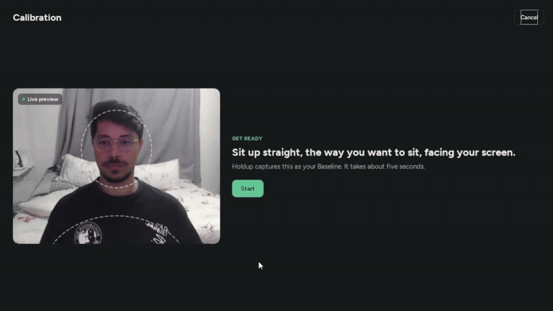

<p align="center">
  <picture>
    <source media="(prefers-color-scheme: dark)" srcset="assets/logo-dark.svg">
    
  </picture>
</p>

<p align="center">Stop leaning into your screen.</p>

<p align="center">
  <a href="https://pablossena.github.io/holdup/">Website</a> |
  <a href="https://github.com/PabloSSena/holdup/releases/latest">Download</a> |
  <a href="LICENSE">License (MIT)</a> |
  <a href="#development">Contribute</a>
</p>

A Windows tray app that watches your sitting posture through your own camera. When you lean forward or to one side for more than 5 seconds, a small Mirror of your live camera feed appears in the bottom-left corner of the screen, and it disappears as soon as you sit well again.

Camera frames are analysed in memory and discarded. Nothing is recorded or sent anywhere.

- **Calibration**: at first launch you sit up straight for a few seconds to capture your Baseline; every judgement compares against it. If the camera view changes a lot (camera moved, another camera chosen) Holdup stops judging and asks you to recalibrate.

<p align="center"></p>

- **Today, History, Settings**: a main window (click the tray icon) shows today's share of time in Good Posture, Forward Lean and Side Lean, past days, and settings: Sensitivity, camera, Baseline, Start with Windows and language (English or Brazilian Portuguese, following Windows by default).
- **Pause** for 30 minutes, 1 hour or until resumed, from the tray menu.
- Daily Stats are numbers only, kept in `%LOCALAPPDATA%\Holdup\holdup.db`.

Download the installer from the [website](https://pablossena.github.io/holdup/) or the [latest GitHub Release](https://github.com/PabloSSena/holdup/releases/latest). Windows 10 or 11 and a webcam.

- Domain glossary: `CONTEXT.md`
- Decisions: `docs/adr/`
- Spec and tickets: `.scratch/posture-monitoring/`, `.scratch/desktop-app/`, `.scratch/website/`

## Development

Run on Windows-side Python 3.11 (not WSL: WSL can't reach the webcam).

Set up the virtualenv:

```
py -3.11 -m venv .venv
.venv\Scripts\python -m pip install -e ".[dev]"
```

Run the app (it lives in the system tray; look in the tray overflow `^` if the icon is hidden. Click it to open the main window, right-click it for the menu and Quit):

```
.venv\Scripts\python -m holdup
```

Run the tests:

```
.venv\Scripts\python -m pytest
```

The MediaPipe pose model (`src/holdup/models/pose_landmarker_lite.task`) is checked in, so the app never needs network access.

## Building the installer

Needs the virtualenv above plus PyInstaller, and [Inno Setup 6](https://jrsoftware.org/isinfo.php) for the installer itself (`winget install JRSoftware.InnoSetup`):

```
.venv\Scripts\python -m pip install -e ".[build]"
powershell -ExecutionPolicy Bypass -File build.ps1
```

This produces `dist\Holdup\Holdup.exe` (the app folder, runnable as is) and `dist\HoldupSetup.exe` (the installer). Without Inno Setup the script stops after the app folder with a warning. The installer (`installer.iss`) is per-user: no admin prompt, installs to `%LOCALAPPDATA%\Programs\Holdup`, adds a Start menu entry and an uninstaller. The pose model and Qt plugins are bundled in the app folder. The installer's version comes from `version` in `pyproject.toml`.

## Releasing

A tag is a name pinned to one commit. Pushing a tag that starts with `v` makes GitHub Actions (`.github/workflows/release.yml`) build the installer and publish it as a GitHub Release, which is what the website's Download button serves:

1. Bump `version` in `pyproject.toml` (for example to `0.2.0`) and commit.
2. `git tag v0.2.0`
3. `git push origin v0.2.0`

The workflow fails if the tag and `pyproject.toml` disagree. Edit the auto-generated release notes on GitHub afterwards if you like.

## Website

The landing page at https://pablossena.github.io/holdup/ lives in `site/` (React + Vite). Pushes to `main` that touch `site/` deploy it (`.github/workflows/pages.yml`).

```
cd site
npm install
npm run dev
npm test
```

## License

MIT, see `LICENSE`.

Third-party: the Figtree font (`src/holdup/fonts/`) is under the SIL Open Font License (`src/holdup/fonts/OFL.txt`), and the MediaPipe pose model (`src/holdup/models/`) is under the Apache License 2.0.
